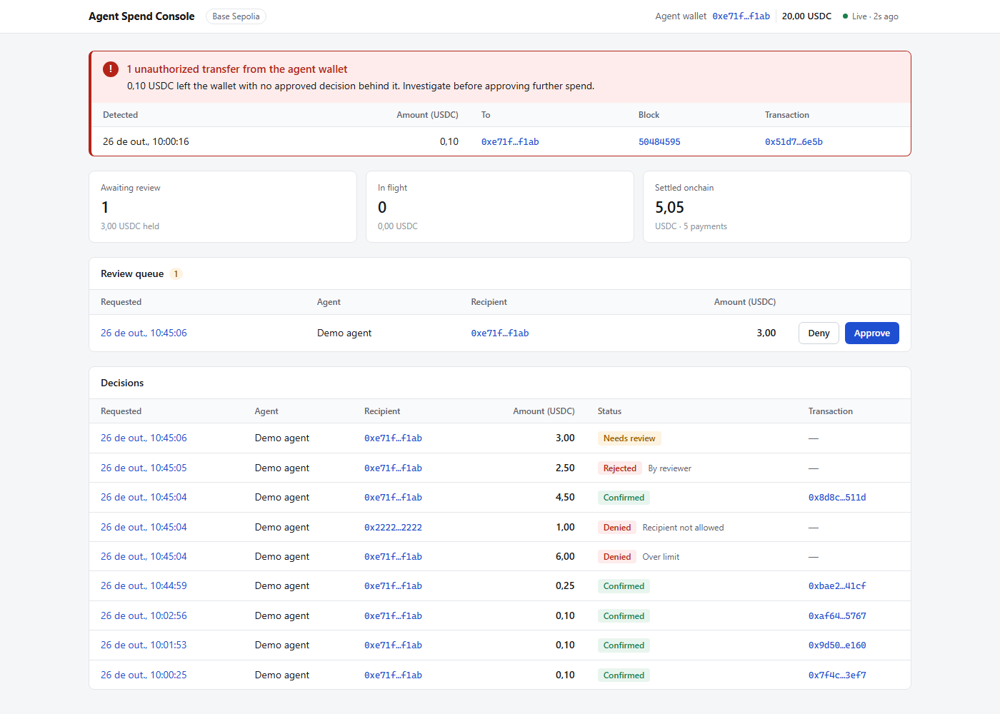
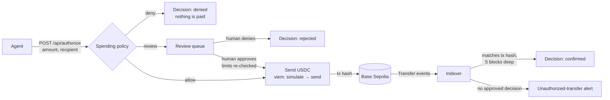

# Agent Spend Tracer

A full-stack TypeScript demo of **policy-controlled payments made by a software agent**, traced
from the moment the agent asks to spend all the way to a confirmed onchain transfer.

A fake "agent" asks to spend USDC. A spending policy allows it, holds it for a human to review,
or denies it. Approved payments go out as real USDC transfers on the **Base Sepolia** testnet, and
an indexer reads the chain back to confirm each transfer and to flag any transfer that has no
approval behind it. A web console shows every step.



---

## The idea in one picture



Every arrow above is recorded in a SQLite database, so for any payment you can answer:
*who asked, what the policy said, who approved it, which transaction paid it, and in which block
it was confirmed.* That trace is the point of the project.

## What happens to one payment, step by step

1. **The agent asks.** `POST /api/authorize` with `{ agentId, amount: "1.50", recipient }`.
   The amount is a human-readable string; the API converts it to USDC's 6-decimal integer units
   with viem's `parseUnits`, never through a floating-point number.
2. **The policy decides.** The agent's *mandate* (its spending rules) is checked in a fixed order:
   revoked? recipient allowed? over the per-payment limit? over the rolling 30-day limit? over the
   review threshold? The outcome is one of `allow`, `review`, `deny_limit`, `deny_recipient`,
   `deny_revoked`, and it is saved as a *decision*. The 30-day check and the save happen in one
   database transaction, so two simultaneous requests cannot both squeeze under the limit.
3. **A human reviews, if needed.** A `review` decision waits in the console's review queue. Approving
   it re-checks the limits as they are *now* (other spending may have happened since); denying it
   ends it.
4. **The payment is sent.** For an allowed (or approved) decision the API simulates the USDC
   `transfer` call, then signs and broadcasts it from the agent's wallet, and stores the
   transaction hash. The decision's payment status becomes `submitted`.
5. **The chain is read back.** The indexer watches USDC `Transfer` events sent from the agent
   wallet. It shows a new transfer as `pending` within seconds, and once the block is 5 blocks
   deep it re-reads that range and marks the transfer `confirmed`, matching it to its decision by
   transaction hash, amount and recipient. The decision becomes `confirmed`.
6. **Anything unexplained is flagged.** A transfer out of the agent wallet with no matching approved
   decision is marked `unauthorized` and shown as a red alert on every page of the console.

Each of these steps has its own document in [`docs/`](docs/) that explains it in detail.

## Repository layout

This is a pnpm monorepo with two apps and one shared package.

```text
agent-spend-tracer/
├── apps/
│   ├── api/                      Node + Fastify + TypeScript backend
│   │   ├── src/
│   │   │   ├── index.ts          starts everything: DB, HTTP server, payment resumer, indexer
│   │   │   ├── app.ts            HTTP routes (buildApp)
│   │   │   ├── policy.ts         the spending policy: authorize, approve, deny
│   │   │   ├── payments.ts       sending a payment and tracking its status
│   │   │   ├── indexer.ts        reading Transfer events back from the chain
│   │   │   ├── chain.ts          everything viem: clients, wallet, USDC sender, event source
│   │   │   ├── config.ts         chain + USDC contract address (cited from Circle's docs)
│   │   │   ├── env.ts            environment variables
│   │   │   ├── seed.ts           creates a demo agent and mandate
│   │   │   ├── db/               Drizzle schema + SQLite client + write queue
│   │   │   └── verdict/          verifier for Saifuro's signed verdicts (standalone, not wired in)
│   │   ├── drizzle/              SQL migrations, applied automatically at startup
│   │   └── test/                 Vitest suites (205 tests)
│   └── web/                      React + Vite + TanStack Query console
│       └── src/                  Overview, review queue, decision trace, alerts
├── packages/
│   └── shared/                   TypeScript types shared by API and web (Decision, Transfer…)
└── docs/                         detailed documentation (start with architecture.md)
```

## Documentation

Read them roughly in this order:

| Document | What it explains |
|---|---|
| [Architecture](docs/architecture.md) | The components, the data model, the state of a decision over time, and how a request flows through the system. **Start here.** |
| [Spending policy](docs/spending-policy.md) | How a request becomes `allow` / `review` / `deny_*`, the rolling 30-day window, review approval and denial, and why concurrency needs special care. |
| [Payments with viem](docs/payments.md) | How a USDC transfer is built, simulated, signed and sent; decimals; nonces; receipts; every way a payment can fail. Written for someone learning viem. |
| [Indexer](docs/indexer.md) | How transfers are read back from the chain, how confirmations and reorgs are handled, how restarts avoid missing anything, and how unauthorized transfers are detected. |
| [Web console](docs/web-console.md) | The pages, how status badges are derived, the timeline, live updates. |
| [API reference](docs/api-reference.md) | Every endpoint with request and response examples and error codes. |
| [Verdict verifier](docs/verdict-verifier.md) | The verifier for Saifuro's signed verdicts: the 12 verification steps, the test vectors, and how it would plug into the app. |
| [Development](docs/development.md) | Setup, environment variables, running, testing, database migrations, troubleshooting. |
| [Design decisions](docs/design-decisions.md) | Every non-obvious choice, the alternatives, and the trade-off. Also the known limitations. |
| [Glossary](docs/glossary.md) | The vocabulary: mandate, decision, verdict, transfer, confirmation, reorg, nonce (two different ones!) and more. |

## Quick start

You need Node 24+ and pnpm (via `corepack enable`). Full details, including Windows notes, are in
[docs/development.md](docs/development.md).

```bash
pnpm install
cp .env.example .env              # then put a TESTNET private key in AGENT_PRIVATE_KEY
```

Fund that wallet on Base Sepolia with test USDC from <https://faucet.circle.com> and a little
Base Sepolia ETH for gas, then:

```bash
pnpm --filter @agent-spend-tracer/api db:seed   # creates a demo agent + mandate, prints a curl
pnpm dev                                        # API on :3001, console on http://localhost:5173
```

Send a payment request (the seed script prints this with your agent id filled in):

```bash
curl -X POST localhost:3001/api/authorize -H "content-type: application/json" \
  -d '{"agentId":"<agent id>","amount":"0.10","recipient":"<recipient from the seed output>"}'
```

Open the console and watch it go from *Submitted* to *Confirmed*. The demo mandate pays the agent
wallet back to itself by default, so no test USDC is lost. Amounts above 2 USDC go to the review
queue; above 5 USDC are denied.

## Scripts

| Command | What it does |
|---|---|
| `pnpm dev` | Runs the API (with file watching) and the web console together. |
| `pnpm test` | Runs every test suite. |
| `pnpm typecheck` | Type-checks every package. |
| `pnpm build` | Builds the web console. |
| `pnpm --filter @agent-spend-tracer/api db:seed` | Creates the demo agent and mandate for the wallet in `.env`. |
| `pnpm --filter @agent-spend-tracer/api db:generate` | Generates a migration after you change `db/schema.ts`. |
| `pnpm --filter @agent-spend-tracer/api verdict:vectors` | Runs Saifuro's 138 verdict test vectors and prints which pass. |

## Status and limitations

This is a demo, built to show the approval-to-chain trace clearly. It deliberately has **no
authentication**, uses **one wallet** (the key in `.env`), runs as **one process** with SQLite, and
only ever touches a **testnet**. The full list of limitations, and what production would need, is
at the end of [docs/design-decisions.md](docs/design-decisions.md#known-limitations).

**Never put a private key that controls real funds in `.env`.** The same key controls the same
address on every chain, including mainnets.
