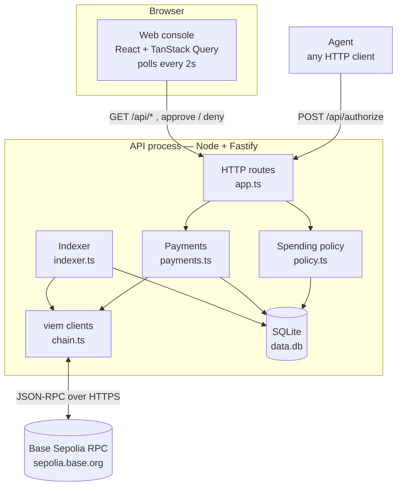
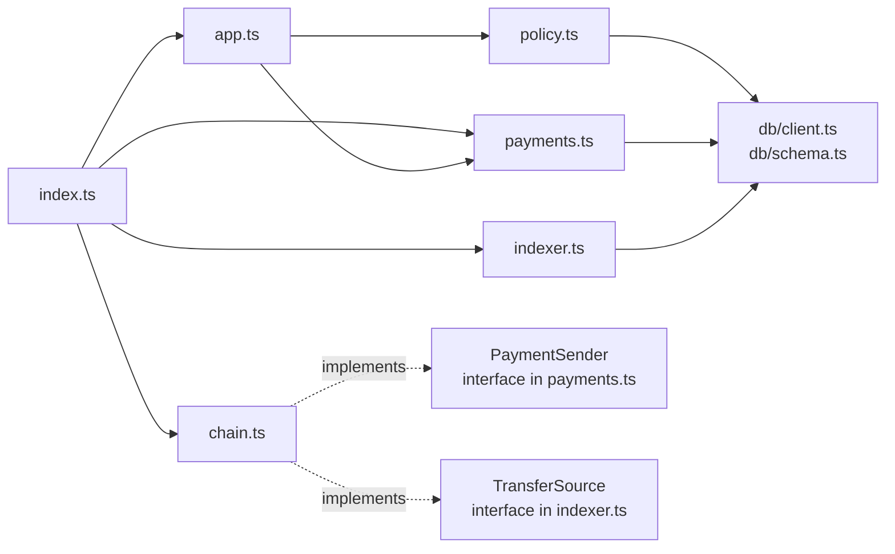
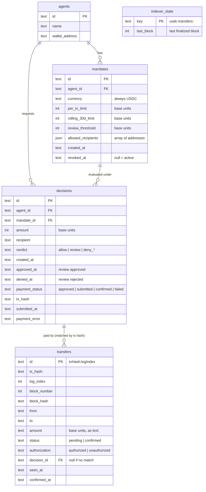
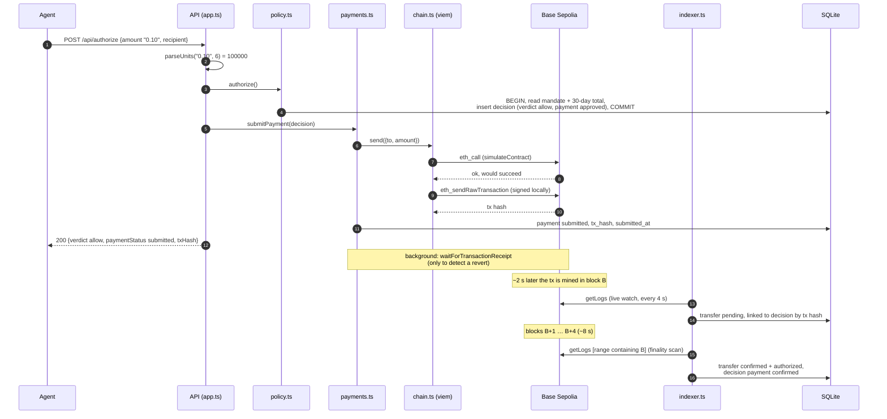
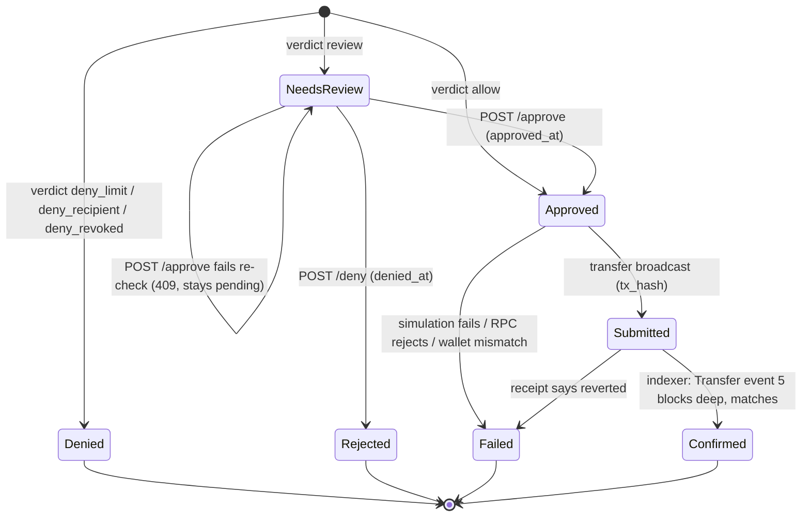
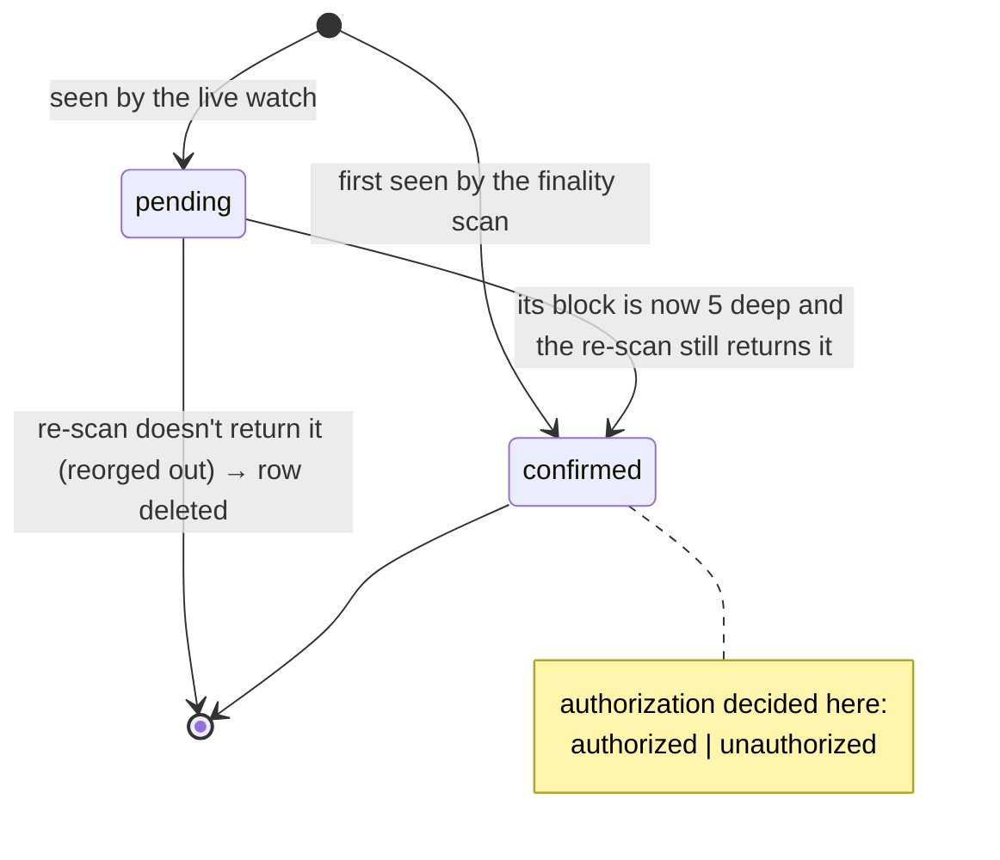

# Architecture

This document explains how the pieces fit together: what runs, what is stored, how one request
travels through the system, and how the state of a payment changes over time. The other documents
zoom into each piece.

- [The moving parts](#the-moving-parts)
- [What runs inside the API process](#what-runs-inside-the-api-process)
- [Module map](#module-map)
- [Data model](#data-model)
- [The life of a payment](#the-life-of-a-payment)
- [State machines](#state-machines)
- [How money and time are represented](#how-money-and-time-are-represented)

## The moving parts



- **The agent** is not a program in this repo. Anything that can send an HTTP request plays the
  agent: `curl`, a script, an LLM tool call. The API trusts the `agentId` it is given; there is no
  authentication (see [design decisions](design-decisions.md#no-authentication)).
- **The API** (`apps/api`) owns all the logic and the database.
- **The web console** (`apps/web`) is a read-mostly view of the database. Its only writes are the
  Approve and Deny buttons.
- **Base Sepolia** is Coinbase's Ethereum layer-2 *testnet*. USDC on it is a real ERC-20 contract
  run by Circle, but the tokens have no value and come free from a faucet.

## What runs inside the API process

One Node process does four jobs concurrently. They share one SQLite database.

| Job | Started by | What it does |
|---|---|---|
| **HTTP server** | `app.listen()` in `index.ts` | Serves the API. Authorizing a request runs the policy and, if allowed, *sends* the payment before responding. |
| **Receipt watchers** | `submitPayment()` for each payment; `resumeConfirmations()` at startup | One background wait per submitted payment, to notice if the transaction **reverts**. |
| **Indexer: live watch** | `indexer.start()` | Polls for new USDC `Transfer` events from the agent wallet and records them as `pending`. |
| **Indexer: finality scan** | `indexer.start()`, then on every new block | Re-reads block ranges that are now deep enough, marks transfers `confirmed`, matches them to decisions, flags unauthorized ones. |

Startup order (`apps/api/src/index.ts`):

```text
createDb(DATABASE_PATH)        open SQLite, apply any new migrations from apps/api/drizzle/
buildApp(db, usdcSender)       register routes
app.listen(API_PORT)           start serving
resumeConfirmations()          re-attach receipt watchers to payments left "submitted" by a previous run
indexer.start()                backfill what happened while the API was down, then watch live
```

If the indexer cannot start (for example the RPC is unreachable), the API still serves requests;
payments just stay `submitted` until the indexer runs again.

## Module map



Two interfaces keep the blockchain out of the business logic:

- **`PaymentSender`** (defined in `payments.ts`): "send this USDC transfer" and "wait for this
  receipt". The real implementation, `usdcSender` in `chain.ts`, uses viem. Tests use a fake that
  never touches a network.
- **`TransferSource`** (defined in `indexer.ts`): "give me Transfer events in this block range",
  "watch for new ones", "tell me about new blocks". The real one, `usdcTransfers` in `chain.ts`,
  uses viem. Tests use a fake chain that can mine, reorganize and restart on command.

Because of this split, **`policy.ts`, `payments.ts` and `indexer.ts` contain no viem calls**, and
all of viem lives in `chain.ts`. That file is the one to read to learn how the app talks to the
chain (see [payments.md](payments.md)).

## Data model



The schema is defined in `apps/api/src/db/schema.ts` with [Drizzle](https://orm.drizzle.team/);
the SQL that creates it is in `apps/api/drizzle/*.sql`.

### agents

An agent is something that spends. Its `wallet_address` is the account the USDC comes *from*.
This demo has a single signing key, so payments only work for the agent whose wallet matches
`AGENT_PRIVATE_KEY`; others fail with a clear error (see [payments.md](payments.md#wallet-check)).

### mandates

A mandate is an agent's spending rules: limits, a review threshold, and an allow-list of
recipients. An agent can have several mandates over time; **the most recently created one is the
one that applies**. Mandates are never edited, only revoked (`revoked_at`) or superseded by a newer
one, so a decision always points at the exact rules it was judged by.

### decisions

One row per spend request. It records two separate things:

- **The verdict**: what the policy said *at request time*. It never changes after creation.
- **The payment**: what happened afterwards, in `payment_status`, `tx_hash`, `submitted_at` and
  `payment_error`, plus the human review outcome in `approved_at` / `denied_at`.

Keeping these apart is what makes the trace honest: a decision that was `allow`ed but whose payment
`failed` shows both facts.

### transfers

One row per USDC `Transfer` event *sent from the agent wallet*, as observed on the chain by the
indexer. This table is deliberately independent of `decisions`: it is filled from the chain, not
from our own records, which is how it can catch money that left without an approval. Its `id` is
`txHash:logIndex` because one transaction can emit several events.

### indexer_state

One checkpoint per watched wallet: the last block number the indexer has fully finalized. After a
restart the indexer continues from here (see [indexer.md](indexer.md#restarts-and-the-checkpoint)).

## The life of a payment

This is one allowed payment end to end, with the real timings seen on Base Sepolia.



What to notice:

- **The HTTP response comes back at step 12**, as soon as the transaction is broadcast, not
  when it is confirmed. Waiting for confirmation would hold the request open for ~10 seconds.
  The console polls to show the rest.
- **The decision is committed before anything is sent** (step 4). If the process crashed right
  after, the decision would exist with status `approved` and no hash, and nothing would be paid
  twice by accident.
- **"Confirmed" comes from the chain, not from our own records.** The receipt only tells us the
  transaction was mined once; the indexer waits until it is 5 blocks deep and re-reads it, which
  protects against reorganizations (see [indexer.md](indexer.md#reorgs)).

A review adds a pause between steps 4 and 5: the decision is created with verdict `review` and no
payment status, waits for a human in the console, and only on approval goes through steps 5–16.

## State machines

### A decision

The verdict is fixed at creation; the path after it depends on the verdict and on what happens next.



The labels are the ones the console shows; the stored fields behind them are in the
[web console doc](web-console.md#status-badges).

### `payment_status`

`null` → `approved` → `submitted` → `confirmed` | `failed`

- `null`: not payable (denied, or a review that is still pending or was rejected).
- `approved`: payable, transfer not sent yet. Usually lasts milliseconds.
- `submitted`: broadcast; the hash is known.
- `confirmed`: the indexer saw the matching Transfer event 5 blocks deep.
- `failed`: no USDC moved (see [payments.md](payments.md#how-a-payment-can-fail) for the one
  edge case where that is not certain).

### A transfer (indexer)



## How money and time are represented

**Money.** USDC has 6 decimal places, so 1 USDC = 1,000,000 *base units*.

| Where | Form | Example for 1.50 USDC |
|---|---|---|
| `POST /api/authorize` body | human-readable string | `"1.50"` |
| Database (`decisions.amount`, limits) | integer base units | `1500000` |
| API responses (`Decision.amount`) | base units as a string | `"1500000"` |
| `transfers.amount` | base units as text | `"1500000"` |
| viem / the chain | `bigint` base units | `1500000n` |
| Console | formatted in the viewer's locale | `1.50` (or `1,50`) |

Amounts never pass through a JavaScript floating-point number. Conversion in uses viem's
`parseUnits` (string math); conversion out uses `formatUnits`. The reasons are in
[payments.md](payments.md#decimals-and-parseunits).

**Time.** Timestamps are ISO-8601 UTC strings (`2026-10-26T13:45:04.000Z`). In that format, text
comparison equals time comparison, which is what lets SQL do `created_at > ?` for the 30-day
window. Block numbers are integers.
