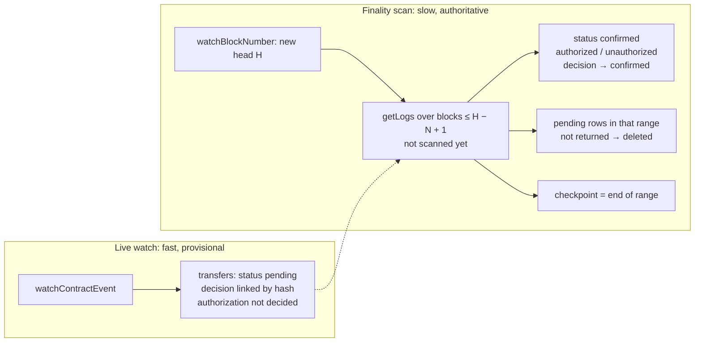

# Indexer

The indexer reads the chain back. It records every USDC transfer that leaves the agent wallet,
confirms it once it is buried deep enough to be final, matches it to the decision that approved it,
and flags any transfer that has no approval behind it.

Code: [`apps/api/src/indexer.ts`](../apps/api/src/indexer.ts) (logic, no viem) and the
`usdcTransfers` source in [`apps/api/src/chain.ts`](../apps/api/src/chain.ts) (the viem calls).

- [Why an indexer at all](#why-an-indexer-at-all)
- [What a Transfer event looks like](#what-a-transfer-event-looks-like)
- [The three viem calls](#the-three-viem-calls)
- [Two paths: the live watch and the finality scan](#two-paths-the-live-watch-and-the-finality-scan)
- [Why not trust the watcher alone](#why-not-trust-the-watcher-alone)
- [Reorgs](#reorgs)
- [Confirmations](#confirmations)
- [Matching a transfer to its decision](#matching-a-transfer-to-its-decision)
- [Restarts and the checkpoint](#restarts-and-the-checkpoint)
- [Living with a public RPC](#living-with-a-public-rpc)
- [Configuration](#configuration)
- [What it does not handle](#what-it-does-not-handle)
- [How it is tested](#how-it-is-tested)

## Why an indexer at all

The payment code already knows what it sent. Why read the chain again?

1. **Our records say what we *intended*; the chain says what *happened*.** A payment we marked
   `submitted` might be dropped, reverted or reorged out. A payment we marked `failed` might have
   gone through anyway (see [payments.md](payments.md#how-a-payment-can-fail)).
2. **Money can leave the wallet without going through our code at all.** Anyone with the private
   key, a bug, a script, a leaked key, can send USDC from the agent wallet. The only way to notice
   is to watch the wallet itself. That is what the **unauthorized** flag is for.
3. **"Confirmed" should mean final.** Only something that reads blocks over time can say a
   transfer is buried deep enough to stay.

## What a Transfer event looks like

When USDC's `transfer` succeeds, the contract emits:

```solidity
event Transfer(address indexed from, address indexed to, uint256 value);
```

In the raw log on chain this becomes:

```text
address  0x036CbD53842c5426634e7929541eC2318f3dCF7e          the USDC contract that emitted it
topics   [0] 0xddf252ad…523b3ef                              keccak256("Transfer(address,address,uint256)")
         [1] 0x000000000000000000000000e71feb26…42f1ab       from, padded to 32 bytes  (indexed)
         [2] 0x000000000000000000000000e71feb26…42f1ab       to, padded to 32 bytes    (indexed)
data     0x…0186a0                                           value = 100000 (0.1 USDC)
```

Plus where it happened: `blockNumber`, `blockHash`, `transactionHash`, and `logIndex` (its position
in the block). `indexed` parameters become *topics*, which nodes can filter on. That is what makes
"only transfers *from* our wallet" a cheap query: the node matches topic 1 against our address and
never sends us the rest of USDC's traffic.

viem decodes these raw logs back into typed values: `log.args.from`, `log.args.to`,
`log.args.value` (a `bigint`).

## The three viem calls

```ts
// chain.ts — usdcTransfers
const transferEvent = getAbiItem({ abi: erc20Abi, name: "Transfer" });

publicClient.getLogs({ address: USDC_ADDRESS, event: transferEvent,
  args: { from: account.address }, fromBlock, toBlock, strict: true });

publicClient.watchContractEvent({ address: USDC_ADDRESS, abi: erc20Abi, eventName: "Transfer",
  args: { from: account.address }, fromBlock, strict: true, onLogs, onError });

publicClient.watchBlockNumber({ onBlockNumber, onError });
```

### `getLogs` — a one-off question about a fixed range

`eth_getLogs` asks: *"every log from this contract, with these topics, in blocks X to Y."* The answer
for a fixed past range is deterministic: ask twice, get the same logs, as long as those blocks are
final. It needs no state on the node between calls.

- `event: transferEvent`: tells viem which event signature to filter on (it computes topic 0) and
  how to decode the results. `getAbiItem` pulls that one entry out of `erc20Abi` with its type.
- `args: { from: account.address }`: becomes the topic-1 filter.
- `strict: true`: drops logs that don't decode cleanly instead of returning them with missing args.

### `watchContractEvent` — "tell me about new ones"

Subscribes to new events going forward and calls `onLogs` with batches. Over HTTP there are no push
notifications, so viem **polls** every `pollingInterval` (4 seconds by default). It has two ways of
polling:

1. **Node-side filter:** `eth_newFilter` creates a filter *on the node*, and `eth_getFilterChanges`
   asks "what's new since I last asked?". The node remembers the cursor.
2. **`getLogs` fallback:** if the node refuses filters, viem remembers the last block it saw and
   calls `getLogs` for the new blocks each time.

This app forces mode 2 (see [why](#why-node-side-filters-are-switched-off)).

### `watchBlockNumber` — "tell me when the chain moves"

Polls `eth_blockNumber` and calls back when it changes. The indexer uses it as a clock: every new
block is a chance to finalize the blocks that just became deep enough. If it skips blocks (polling
every 4 s on a 2 s chain), that is fine: the indexer only needs the latest number.

## Two paths: the live watch and the finality scan

The indexer combines both kinds of call, with different jobs:



- **The live watch** (`ingestPending`) inserts transfers as `pending` within seconds of being
  mined, so the console can show them. It decides nothing.
- **The finality scan** (`finalizeRange`, driven by `sync`) runs whenever a new block arrives. It
  takes every block range that has become N blocks deep and has not been scanned yet, fetches it
  with `getLogs`, and treats that result as the truth: everything returned is `confirmed` and
  matched; any `pending` row in that range that is *not* returned is deleted. Then it moves the
  checkpoint past that range. All of that happens in one database transaction, so a crash can't
  leave a range half-processed.

## Why not trust the watcher alone

A watcher is an in-memory cursor that reports what it happens to see while it is running. Four
things go wrong if it is the only source:

1. **Downtime.** A watcher starts at "now". Anything mined while the API was stopped or
   restarting is never reported. You need to be able to ask "what happened between block X and
   block Y?" after the fact, which is exactly `getLogs` over a range.
2. **Lost polls.** Polling over HTTP fails sometimes: timeouts, rate limits, errors. Depending on
   the mode, a failed poll can skip a window. With node-side filters on a load-balanced RPC this is
   not hypothetical: it happened on the first live run here (see
   [below](#why-node-side-filters-are-switched-off)).
3. **Reorgs.** The watcher reports logs from the newest blocks, which are the ones that can still
   be replaced. Over HTTP polling, viem does not reliably tell you when a log it already gave you was
   removed. Trusting it would mean confirming transfers that later vanish.
4. **No durable position.** If the watcher is the only path, there is nothing to resume from after
   a restart.

`getLogs` over a fixed, already-final range has none of these problems: it is stateless,
repeatable, and has a clear "I have processed up to here" (the checkpoint). The watcher is kept
because it is *fast*. The design uses the watcher for latency and `getLogs` for correctness.

## Reorgs

A **reorganization** happens when the chain's most recent blocks are replaced by a different
version of them. Briefly, two versions of block 101 can exist, and the network settles on one; every
transaction only in the losing version is undone (it may get re-included later, in another block).
The deeper a block is under newer blocks, the less likely it is to be replaced.

Base is an OP-Stack layer 2: a single sequencer orders transactions, so short reorgs are rare, but
blocks are only truly final once the corresponding data is final on Ethereum (L1), which takes
minutes. "Rare" is not "never", and a payments system has to be correct in the rare case.

How the indexer handles the cases (all three are tested):

| What happened | What the finality scan sees | Result |
|---|---|---|
| Transfer seen in block 101, block replaced without it | getLogs for 101 doesn't return it | `pending` row deleted; decision stays `submitted` |
| Transfer moved from block 101 to block 102 | not in 101 → deleted; later found in 102 | `confirmed` at block 102 with the new block hash |
| Transfer stays in block 101 | returned | `confirmed` |

It does **not** handle reorgs deeper than N blocks: by the time a range is scanned it is assumed
final, and it is never scanned again.

## Confirmations

A transfer in block `B`, when the newest block is `H`, has `H − B + 1` **confirmations** (its own
block counts as one). The indexer waits for `N` (`INDEXER_CONFIRMATIONS`, default 5):

```text
block B is final  ⇔  H − B + 1 ≥ N  ⇔  B ≤ H − N + 1
```

So on each new head `H`, `sync` finalizes everything up to `finalTo = H − N + 1`.

**Why wait at all?** Because of reorgs: if you tell a merchant "paid" one block in and the block is
replaced, you have reported money that didn't move. Waiting trades speed for certainty.

**Why 5?** A practical demo value: about 10 seconds on Base, deep enough that a sequencer-level
reorg is very unlikely. It is a dial, not a constant. For real money the choice depends on the
amount and on how bad a wrong "confirmed" is. viem can also read the `"safe"` and `"finalized"`
block tags (`getBlock({ blockTag: "finalized" })`), which on an OP-Stack chain track L1 safety;
using `finalized` as the scan boundary instead of `H − N + 1` would give real finality at the cost of
minutes of delay.

## Matching a transfer to its decision

When a transfer is confirmed, `match()` looks for its decision and decides whether it is
**authorized**. All four must hold:

1. A decision has this transaction hash (`decisions.tx_hash = transfer.tx_hash`).
2. That decision was **approved**: verdict `allow`, or a `review` with `approved_at` set.
3. It is **the same payment**: the decision's amount equals the event's value, and the recipient
   equals the event's `to` (case-insensitive hex).
4. **No other confirmed transfer has already claimed that decision.** One approval pays once, even
   if a transaction somehow emitted two identical events.

Otherwise the transfer is `unauthorized`. It keeps a link to the decision it *claimed* to be, if
any, so an amount or recipient mismatch can be investigated. Unauthorized transfers are logged at
error level and shown at the top of every console page.

If authorized, the decision's `payment_status` becomes `confirmed`.

**Why decide at confirmation, not when first seen?** Timing. `submitPayment` stores the hash a few
milliseconds *after* broadcasting. If a block were mined and seen in between, an early decision
would wrongly flag our own payment as unauthorized. By confirmation time, about 10 seconds later,
the hash has long been saved. There is a test for exactly this race.

## Restarts and the checkpoint

The checkpoint is one row in `indexer_state`: key `usdc-transfers:<wallet address>`, value
`last_block`, meaning **every block up to here has been finalized by a `getLogs` scan**. It only
moves forward inside the same transaction that writes that range's results.

What `indexer.start()` does:

```text
head = latest block number
if no checkpoint: checkpoint = (INDEXER_START_BLOCK or head) − 1        fresh database
sync(head)                         backfill: finalize (checkpoint, head − N + 1] in 200-block chunks
ingestPending(getLogs(tail))       the last N − 1 blocks, not final yet, shown as pending
watchContractEvent(from head + 1)  live: starts exactly after the backfill, no gap
watchBlockNumber → sync            finalize as the chain moves
```

So if the API is down from block 1,000 to block 5,000, the next start finalizes 1,000–4,996 with
twenty `getLogs` calls, shows 4,997–5,000 as pending, and continues live from 5,001. Nothing in
between is skipped, and nothing is processed twice in a way that matters: inserts are idempotent
(`ON CONFLICT`), keyed by `txHash:logIndex`.

Other details:

- A live event for a block the scan has already finalized is ignored. If it had been in the scan's
  result it is already there; if it wasn't, it was reorged out and must not reappear as `pending`
  forever.
- Syncs run one at a time, in order (a promise queue), so two blocks arriving together can't
  finalize the same range twice.
- If a sync fails (RPC error), it is logged and the next block retries from the same checkpoint.

## Living with a public RPC

The first live run against `https://sepolia.base.org` exposed three real problems. All are fixed
and covered by tests.

### `eth_getLogs` is limited to 200 blocks

The public endpoint rejects ranges over 200 blocks (`eth_getLogs is limited to a 200 range`). The
backfill and the finality scan split work into chunks of `INDEXER_CHUNK_SIZE` blocks (default
200). Paid RPC providers allow much larger ranges; raise it there.

### A failed backfill used to crash startup

Startup's "pending tail" fetch originally covered the whole unscanned gap in one request, threw, and
took the process down. Now the tail is at most the last N − 1 blocks (older blocks are the scan's
job), and failures there are logged instead of fatal.

### Why node-side filters are switched off

With filters on, every poll failed with `eth_getFilterChanges → filter not found`. A filter lives in
the memory of **one** node. `sepolia.base.org` is a load balancer over many nodes, so the poll that
asks for changes usually lands on a different node from the one that created the filter. viem
recreates filters only for a different error code, so the watch kept failing; events got through
only when a poll happened to reach the right node.

The fix is one line in `chain.ts`:

```ts
const transport = http(env.rpcUrl, { methods: { exclude: ["eth_newFilter"] } });
```

viem now refuses to create filters locally, its filter setup fails, and `watchContractEvent` falls
back to polling `getLogs` over new blocks, which is stateless and works whichever node answers.
After this, the live watch reported a real transfer **0.3 seconds after it was mined**, with no
errors.

## Configuration

| Variable | Default | Meaning |
|---|---|---|
| `INDEXER_CONFIRMATIONS` | `5` | Blocks a transfer must be under (counting its own) before it is confirmed. |
| `INDEXER_START_BLOCK` | the head at first start | First block to index on a fresh database. Set it to backfill history. |
| `INDEXER_CHUNK_SIZE` | `200` | Blocks per `eth_getLogs` request. |

To re-index from scratch, delete the row in `indexer_state` (and the `transfers` rows) and restart
with `INDEXER_START_BLOCK` set.

## What it does not handle

- **Reorgs deeper than `INDEXER_CONFIRMATIONS`.** A finalized range is never re-read.
- **Only one wallet:** the one whose key is in `.env`, outgoing transfers only. Agents with other
  wallets are not indexed.
- **Only USDC `Transfer` events.** ETH movements (gas, or sending ETH) and other tokens are not
  watched, so draining the wallet's ETH would not raise an alert.
- **Single process.** The sync queue and the write queue are in-process. Two API instances would
  both index; inserts are idempotent so results stay correct, but a shared database such as
  Postgres would be the real fix.

## How it is tested

`apps/api/test/indexer.test.ts` uses a fake `TransferSource`: a chain held in memory that a test can
mine blocks on, reorganize, stop and restart, and that rejects `getLogs` ranges over 200 blocks like
the real RPC. Scenarios covered:

- a live transfer goes `pending` → still pending at 2 confirmations → `confirmed`/`authorized` at 3
  (tests use N = 3), and its decision becomes `confirmed`;
- unauthorized cases: no decision; wrong amount; wrong recipient; an unapproved review; two events
  claiming one decision;
- a transfer seen before its decision stored the hash is still matched;
- reorged out → row deleted, decision stays `submitted`; moved to a later block → confirmed there;
  a late live event for an already-finalized block → ignored;
- restart: backfills the gap, sets the checkpoint to `H − N + 1`, resumes the watch at `H + 1`;
  long gaps in contiguous 200-block chunks; a failed backfill doesn't stop startup and the next block
  catches up; `INDEXER_START_BLOCK` on a fresh database.

The tests were also checked against deliberately broken versions of the indexer: skipping the
deletion of reorged-out rows fails 2 tests; accepting live events for finalized blocks fails 1;
confirming without waiting for N blocks fails 5.
