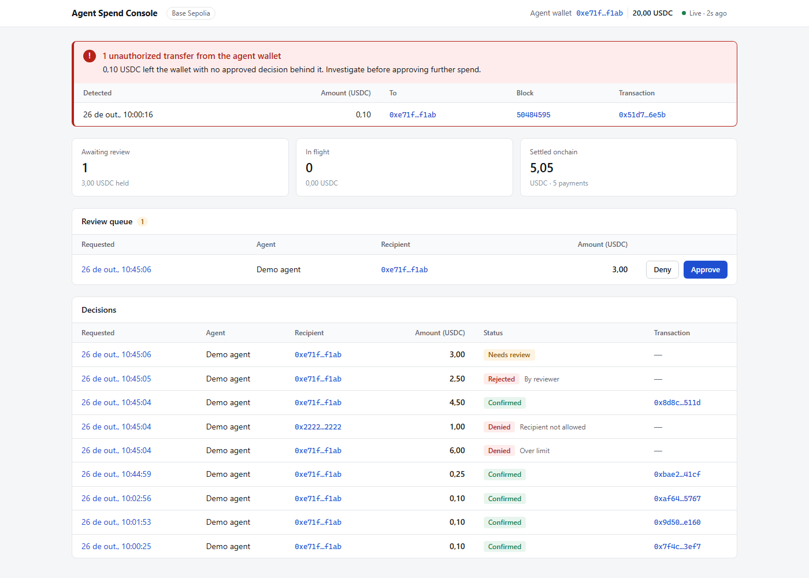
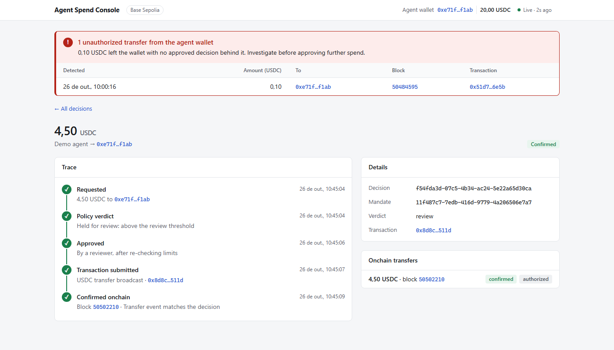
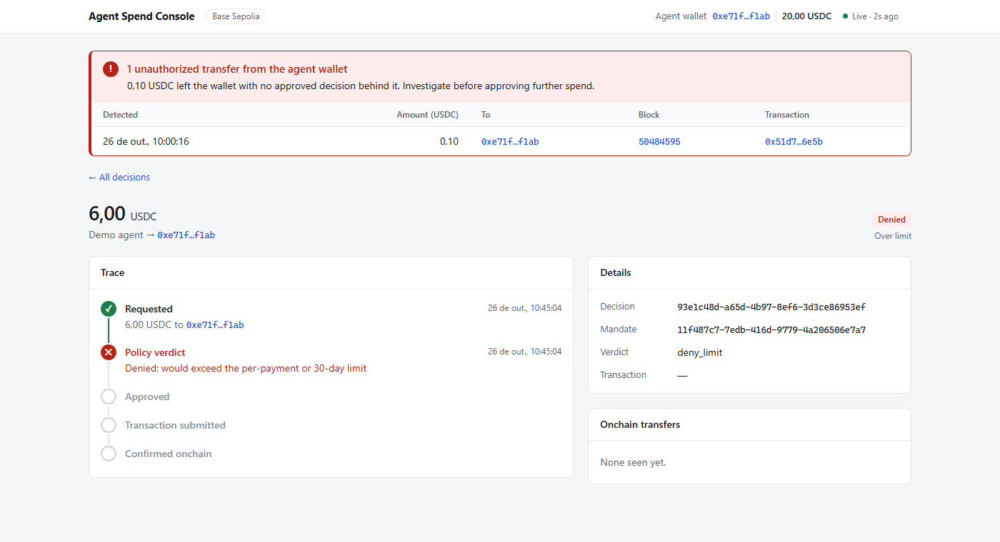
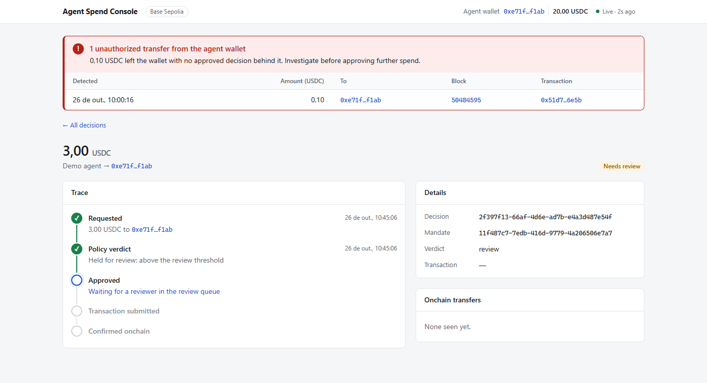

# Web console

The console (`apps/web`) shows every decision and traces each payment from request to chain. It is
React + Vite + TanStack Query, with no UI library: plain CSS in
[`src/styles.css`](../apps/web/src/styles.css).

Run it with `pnpm dev` and open <http://localhost:5173>. Vite forwards `/api/*` to the API on port
3001, so the browser only ever talks to one origin.

- [Pages](#pages)
- [Status badges](#status-badges)
- [The trace timeline](#the-trace-timeline)
- [Live updates](#live-updates)
- [Code map](#code-map)
- [Formatting](#formatting)

## Pages

There are two routes, handled by a 20-line hash router (`router.ts`) rather than a routing library.

### Overview — `#/`



From top to bottom:

1. **Header**: the agent wallet (links to BaseScan), its live USDC balance, the network, and a
   *Live · Ns ago* indicator.
2. **Unauthorized-transfer alert** (only when there are any; on every page): a red panel listing
   each transfer out of the wallet that no approved decision explains, with amount, recipient,
   block and transaction links.
3. **Summary tiles**: how many reviews are waiting (and how much USDC they hold), payments in
   flight, and the total settled onchain.
4. **Review queue**: every pending review with **Approve** and **Deny** buttons. If approval is
   refused on re-check, the row says why inline ("Would exceed limits now").
5. **Decisions table**: the latest 100 decisions with a status badge, denial reason, and transaction
   link. Click a row to open its trace.

### Decision trace — `#/decisions/:id`

| Confirmed payment | Denied by policy | Waiting for review |
|---|---|---|
|  |  |  |

The amount and status, a five-step **trace** timeline, the decision's identifiers, and the onchain
transfers matched to it with their status and authorization.

## Status badges

The database stores a decision's state in several fields. `decisionStatus()` in `format.ts` turns
them into one label, checking in this order:

| Condition | Badge | Shown reason |
|---|---|---|
| `verdict` is `deny_limit` / `deny_recipient` / `deny_revoked` | **Denied** (red) | Over limit / Recipient not allowed / Mandate revoked |
| `deniedAt` set | **Rejected** (red) | By reviewer |
| `verdict` is `review`, `approvedAt` not set | **Needs review** (amber) | |
| `paymentStatus` `submitted` | **Submitted** (blue) | Awaiting confirmations |
| `paymentStatus` `confirmed` | **Confirmed** (green) | |
| `paymentStatus` `failed` | **Failed** (red) | the `paymentError` |
| otherwise (`approved`, about to be sent) | **Approved** (grey) | |

In the decisions table, the reason for a red badge is shown next to it, not only on hover.

## The trace timeline

`buildSteps()` in `DecisionDetail.tsx` always shows the same five steps, so every trace reads the
same way:

1. **Requested**: `createdAt`; amount and recipient.
2. **Policy verdict**: `createdAt`; the verdict in words.
3. **Approved**: automatically for `allow` (`createdAt`), or by a reviewer (`approvedAt`).
4. **Transaction submitted**: `submittedAt`; the transaction hash, linked to BaseScan.
5. **Confirmed onchain**: the transfer's `confirmedAt`; the block number, linked to BaseScan.

Each step is *done* (green check), *current* (blue ring), *failed* (red cross) or *upcoming*
(grey). The timeline stops at the first failure: a `deny_limit` shows a red Policy verdict and greys
out the rest; a rejected review shows a red "Rejected" step; a failed simulation shows a red
"Transaction submitted" with the reason. While a payment is mined but not yet deep enough, step 5
reads "Mined in block N, waiting for confirmations".

## Live updates

Every view polls with TanStack Query's `refetchInterval`: decisions and transfers every 2 seconds,
the wallet balance every 10. After Approve or Deny, the decision queries are invalidated so the
change shows immediately.

Polling rather than Server-Sent Events or WebSockets: Base produces a block every ~2 seconds and a
payment needs 5 blocks to confirm, so a 2-second poll is as fast as anything the chain can show, and
it needs no server code. The *Live* indicator turns to *Reconnecting…* if no poll has succeeded for
10 seconds. The trade-off is discussed in
[design-decisions.md](design-decisions.md#polling-instead-of-server-sent-events).

## Code map

```text
apps/web/src/
├── main.tsx               mounts <App> inside a QueryClientProvider
├── App.tsx                header + alerts + route switch
├── router.ts              hash router: #/ and #/decisions/:id
├── api.ts                 fetch wrapper, ApiError, one hook per endpoint, approve/deny mutation
├── format.ts              usdc(), dates, explorer links, decisionStatus()
├── components.tsx         Badge, StatusBadge, ChainLink, BlockLink, Panel, LiveIndicator, …
├── UnauthorizedAlerts.tsx the red alert panel
├── Overview.tsx           summary tiles, review queue, decisions table
├── DecisionDetail.tsx     trace timeline and details
└── styles.css             design tokens (light + dark), layout, components
```

## Formatting

- **Amounts**: `formatUnits(baseUnits, 6)` (exact), then `Intl.NumberFormat` in the viewer's locale
  for display only, so `1.50` in en-US and `1,50` in pt-BR.
- **Dates**: the viewer's locale and time zone.
- **Block numbers**: no thousands separators, the way block explorers show them.
- **Addresses and hashes**: shortened (`0xe71f…f1ab`), full value on hover, linked to
  `sepolia.basescan.org`.
- **Dark mode** follows the system setting. Below 800px wide, low-priority columns are hidden and
  wide tables scroll inside their panel.
